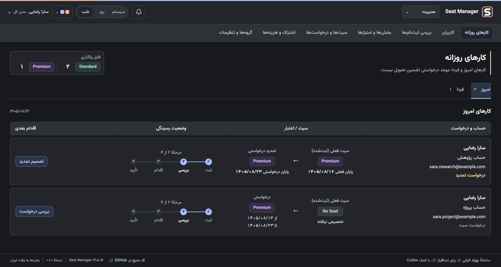
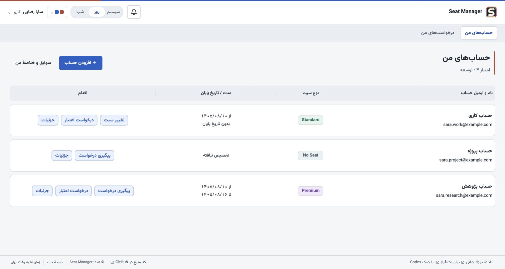
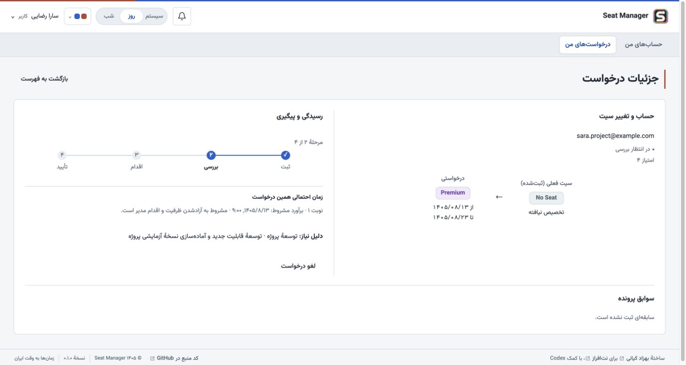
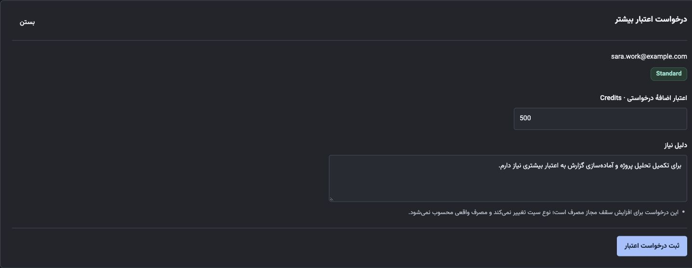

<div dir="rtl">

# مدیریت حساب‌ها و سیت‌ها

برنامهٔ **Seat Manager** سامانه‌ای فارسی برای مدیریت درخواست حساب، سیت و کردیت OpenAI در شرکت‌هاست. کارکنان درخواست خود را ثبت می‌کنند و مدیر، تغییر تأییدشده را در پنل OpenAI انجام می‌دهد و نتیجهٔ بررسی‌شده را در برنامه ثبت می‌کند.

هر فرد پنل شخصی خود را دارد. مدیران می‌توانند درخواست‌ها را اولویت‌بندی کنند، ظرفیت را ببینند، تمدید و انتقال سیت را پیگیری کنند و از طریق اعلان و ایمیل به کارکنان اطلاع بدهند.

## نمونه‌هایی از محیط برنامه

تصویرها از رابط واقعی برنامه با داده‌های ساختگی گرفته شده‌اند. نام‌ها، ایمیل‌ها، ظرفیت‌ها و درخواست‌های نمایش‌داده‌شده برای معرفی امکانات هستند.

### کارهای روزانهٔ مدیر در تم تیره

تمدیدهای در انتظار، تغییر سیت فعلی و درخواستی، مرحلهٔ رسیدگی و اقدام بعدی در یک نما دیده می‌شوند. کارهای امروز و فردا زبانه‌های جدا دارند.



<details>
<summary>پنل شخصی و حساب‌های کاربر در تم روشن</summary>

هر فرد می‌تواند چند حساب نام‌گذاری‌شده داشته باشد و وضعیت سیت، تاریخ پایان و مسیر درخواست هر حساب را ببیند.



</details>

<details>
<summary>پیگیری درخواست و زمان احتمالی رسیدگی</summary>

پروندهٔ درخواست، سیت فعلی و درخواستی را کنار خط زمان رسیدگی، نوبت و برآورد مشروط دریافت نشان می‌دهد.



</details>

<details>
<summary>فرم درخواست کردیت بیشتر</summary>

کاربر، مقدار اعتبار اضافه و دلیل نیاز را برای حساب انتخاب‌شده وارد می‌کند. مدیر، درخواست را بررسی می‌کند و نتیجهٔ اقدام دستی در OpenAI را ثبت می‌کند.



</details>

## امکانات

- ثبت چند حساب نام‌گذاری‌شده برای هر نفر، با وضعیت‌های Standard، Premium و No Seat.
- درخواست دریافت یا تغییر سیت، تخصیص موقت یا بدون تاریخ پایان، تمدید و انتقال سیت بین دو حساب.
- درخواست کردیت اضافه با دلیل اجباری، تأیید یا تغییر مقدار توسط مدیر، بررسی دستی در OpenAI و ثبت سوابق مستقل. مقدارهای درخواستی و تأییدشده در سوابق مستقل ثبت می‌شوند؛ مصرف واقعی از پنل OpenAI بررسی می‌شود.
- گروه‌های دسترسی قابل تعریف، مستقل از بخش سازمانی و امتیاز اولویت؛ با گروه‌های آمادهٔ مدیر کل، منابع انسانی، اپراتور و کاربر. هر فرد عضو یک گروه دسترسی است.
- میز کار روزانه، صف کامل سیت‌ها و درخواست‌ها، بررسی ثبت‌نام‌ها و دسترسی همهٔ نقش‌ها به حساب‌ها و سوابق شخصی خودشان.
- نمایش ظرفیت خریداری‌شده، تخصیص‌یافته، کنارگذاشته‌شده و آزاد، تخمین زمان انتظار بر اساس شرایط صف و ثبت سابقهٔ اقدامات.
- ثبت‌نام با دامنهٔ سازمانی مجاز، تأیید ایمیل و فعال‌سازی توسط مسئول مجاز، همراه با بازیابی رمز عبور.
- اعلان داخل برنامه، صف ارسال ایمیل و یادآوری پایان سیت موقت. تنظیم فرستندهٔ SMTP در اختیار مدیر کل است و ابزار بررسی اتصال، ارسال آزمایشی و مشاهدهٔ وضعیت صف و زمان‌بند دارد.
- خلاصهٔ مدت استفادهٔ ثبت‌شده از Standard و Premium، تغییر سیت‌ها، تمدیدها و درخواست‌های کردیت، به تفکیک فرد و حساب.
- ایمیل‌های فارسی با قالب خوانا و نسخهٔ متنی جایگزین.
- رابط راست‌به‌چپ، انتخاب‌گر تاریخ شمسی، ساعت ایران، تم روشن و تیره و هماهنگ با سیستم، همراه با رنگ‌بندی قابل انتخاب برای هر کاربر.

## وضعیت نسخه

فرانت‌اند و بک‌اند به هم متصل‌اند و ابزار ساخت بستهٔ کامل نصب در دسترس است. در اولین راه‌اندازی، مالک برنامه ایمیل و رمز دلخواه خود را برای مدیر کل تعیین می‌کند. هر نصب، پایگاه داده، تنظیمات خصوصی، HTTPS و زمان‌بند یادآوری مخصوص خود را دارد.

مدیر کل از تنظیمات برنامه، مشخصات فرستندهٔ ایمیل را ذخیره می‌کند، اتصال و دریافت ایمیل آزمایشی را بررسی می‌کند و سپس ارسال خودکار را فعال می‌کند. ارسال خودکار پس از نصب تازه یا ارتقای تنظیمات ایمیل، ابتدا خاموش است. ورود اولیه با رمز انتخاب‌شده انجام می‌شود و به دریافت ایمیل وابسته نیست.

## دریافت و نصب روی هاست

بستهٔ آمادهٔ **`seat-manager-v0.1.0-beta.3.zip`** را از [صفحهٔ انتشار نسخه](https://github.com/kiyanibehzad/seat-manager/releases/tag/v0.1.0-beta.3)، بخش فایل‌های پیوست (**Assets**)، دریافت کنید.

این بسته شامل رابط ساخته‌شده، وابستگی‌های PHP، فونت وزیرمتن و راهنمای نصب است. برای نصب آن روی هاست، اجرای Node.js یا Composer لازم نیست. فایل `SHA256SUMS.txt` کنار بسته برای کنترل صحت دانلود در دسترس است. آرشیوهای خودکار **Source code** گیت‌هاب، سورس توسعه هستند و وابستگی‌های آمادهٔ نصب را ندارند.

طبق [راهنمای نصب](docs/backend/INSTALL.md)، پایگاه داده و تنظیمات خصوصی نصب خودتان را آماده کنید. فقط پوشهٔ `public_html/` باید از وب قابل دسترسی باشد. سپس صفحهٔ `/install.html` را روی HTTPS باز کنید و اولین مدیر کل را بسازید. اطلاعات ورود را خودتان هنگام نصب تعیین می‌کنید؛ این نسخهٔ آزمایشی، داده یا تنظیمات نصب دیگری را همراه ندارد.

## راهنمای تصویری فارسی

[دریافت راهنمای PDF، ۲۸ صفحه، ویرایش ۳](docs/user-guide/seat-manager-training-fa.pdf)

راهنما، مدیریت برنامه و مثال‌های قدم‌به‌قدم ثبت درخواست سیت، تمدید، انتقال Premium و درخواست کردیت را توضیح می‌دهد. در ویرایش ۱۰ آبان ۱۴۰۵ (۱ نوامبر ۲۰۲۶)، بخش‌های کنسول OpenAI با عکس‌های واقعی و بی‌نام به‌روز شده‌اند.

| کار مدیر در کنسول | صفحه |
|---:|---:|
| تغییر سیت یک عضو از ستون **Seat type** | ۱۰ |
| تعیین سقف پیش‌فرض نوع سیت یا سقف کردیت یک نفر | ۱۱ و ۲۲ |
| دیدن سهمیهٔ پنج‌ساعته و هفتگی، توکن و کردیت مصرفی یک نفر | ۲۵ و ۲۶ |

[فهرست کامل مطالب و جزئیات ویرایش](docs/user-guide/README.md)

بستهٔ نصب، راهنمای موجود در زمان ساخت خود را دارد. برای جدیدترین ویرایش، PDF بالا را دریافت کنید. تنظیم هدرهای پاسخ برای Apache، LiteSpeed و Nginx در [راهنمای هدرهای امنیتی](docs/backend/SECURITY-HEADERS.md) آمده است. هنگام ارتقا، تنظیمات خصوصی و داده‌های نصب فعلی را حفظ کنید؛ صفحهٔ نصب اولیه مخصوص راه‌اندازی تازه است.

## ساخت و اجرای محلی

محیط اجرا به **PHP 8.3 یا بالاتر**، افزونه‌های PDO MySQL، OpenSSL و mbstring، پشتیبانی از نشست و پایگاه دادهٔ MySQL یا MariaDB با InnoDB و utf8mb4 نیاز دارد. Composer و Node.js برای آماده‌سازی وابستگی‌ها و ساخت رابط در محیط توسعه استفاده می‌شوند.

<div dir="ltr">

```sh
git clone https://github.com/kiyanibehzad/seat-manager.git
cd seat-manager
composer install --working-dir=backend --no-dev --prefer-dist
node frontend/build.mjs
```

</div>

سپس [راهنمای راه‌اندازی محلی](docs/SETUP.md) را دنبال کنید. ابزار کمکی اجرای محلی، علاوه بر این موارد به Python 3 و ابزارهای خط فرمان MariaDB نیاز دارد. گیرندهٔ ایمیل آزمایشی آن روی همان دستگاه کار می‌کند و پیام‌ها را به صندوق ایمیل واقعی نمی‌فرستد.

تنظیمات خصوصی، پایگاه داده، نشست‌ها و ایمیل‌های آزمایشی وارد مخزن نمی‌شوند. فایل‌های لازم رابط و فونت از خود برنامه بارگذاری می‌شوند و به سرویس بیرونی وابسته نیستند.

## ساخت بستهٔ نصب

پس از ساخت رابط و آماده‌سازی وابستگی‌های PHP، بستهٔ کامل را در مسیری بیرون از پوشهٔ عمومی وب بسازید و بررسی کنید.

<div dir="ltr">

```sh
php bin/build-release.php /absolute/new-seat-manager-release.zip
php tests/backend/release-package.php /absolute/new-seat-manager-release.zip
```

</div>

بستهٔ خروجی، تنظیمات واقعی، کلید نصب یا داده‌های محیط محلی را همراه ندارد. برای انتشار عمومی، حالت زیر صحت فونت‌های وزیرمتن و فایل‌های مجوز همراهشان را نیز بررسی می‌کند.

<div dir="ltr">

```sh
node frontend/build.mjs --public
php bin/build-release.php --public /absolute/new-seat-manager-public.zip
php tests/backend/release-package.php --public /absolute/new-seat-manager-public.zip
```

</div>

حالت عمومی فقط نسخهٔ مشخص‌شدهٔ وزیرمتن و فایل‌های مجوز و پدیدآورندگان آن را می‌پذیرد و فونت خصوصی یا ناشناخته را رد می‌کند. هر دو حالت ساخت، این راهنما، توضیحات وابستگی‌ها، راهنمای نصب و فهرست هش فایل‌ها را در بسته قرار می‌دهند. همهٔ خروجی‌ها از فونت وزیرمتن همراه برنامه استفاده می‌کنند.

## فونت و وابستگی‌ها

برنامه سه وزن معمولی، متوسط و ضخیم فونت **وزیرمتن، نسخهٔ ۳۳٫۰۰۳** را همراه مجوز SIL Open Font License و مشخصات پدیدآورندگان در خود دارد. فونت از فایل‌های خود برنامه بارگذاری می‌شود و به نصب فونت روی دستگاه کاربر یا سرویس فونت بیرونی نیاز ندارد.

فایل‌های قدیمی فونت خصوصی، در صورت وجود در محیط توسعه، وارد خروجی ساخت نمی‌شوند. اطلاعات نسخه‌ها و مجوزها در [توضیحات وابستگی‌ها](THIRD_PARTY.md) آمده است.

## توسعه و آزمون

آزمون‌های رفتار رابط را با فرمان زیر اجرا کنید.

<div dir="ltr">

```sh
node --test frontend/tests/*.test.mjs
```

</div>

آزمون‌های یکپارچهٔ بک‌اند از پایگاه دادهٔ آزمایشی جدا استفاده می‌کنند و بعضی از آن‌ها محتوای آن را بازسازی می‌کنند. این آزمون‌ها را روی پایگاه داده‌ای که می‌خواهید حفظ شود اجرا نکنید.

مستندات فنی شامل [راه‌اندازی](docs/SETUP.md)، [رابط هویت و اعلان](docs/backend/API.md)، [گروه‌های دسترسی](docs/backend/ACCESS-GROUPS-CONTRACT.md)، [رابط عملیات](docs/backend/API-OPERATIONS.md)، [رفتار کارهای دوره‌ای](docs/backend/OPERATIONS.md) و [تنظیم و ارسال ایمیل](docs/backend/MAIL.md) هستند.

## مجوز استفاده

هنوز مجوز متن‌باز سراسری برای پروژه انتخاب نشده است. عمومی‌بودن مخزن به‌تنهایی مجوز نرم‌افزاری اضافه‌ای ایجاد نمی‌کند. هر وابستگی، مجوز خودش را دارد؛ جزئیات در [توضیحات وابستگی‌ها](THIRD_PARTY.md) ثبت شده است.

</div>
